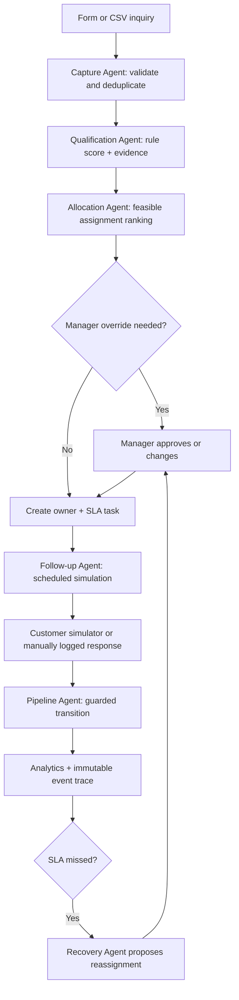

# LeadPilot AI — Complete Startup & Product Blueprint

**Version:** 1.0 | **Research date:** 2026-11-08 | **Status:** pre-validation concept; specifications, not implemented software.

## 1. Executive summary, mission and positioning

**One-liner:** a Pakistan-first lead-response operating system that converts messy inbound inquiries into assigned, time-bound, auditable follow-ups, and reveals *where* sales opportunities are lost.

**Buyer:** owner or sales manager of a 3–20-person sales team. **Initial vertical hypothesis:** Islamabad/Rawalpindi education/training institutes and small property lead teams; test both, choose the segment with higher lead volume and access to CRM data. **Initial distribution:** founder-led in-person demos, not paid ads. **Critical promise to validate:** fewer leads ignored, faster first response, clearer staff accountability and measurable qualified-pipeline progression. **Never promise a conversion lift before a controlled pilot.**

**Mission:** help small service firms establish discipline around every legitimate inquiry without requiring enterprise CRM administration. **Vision:** outcome-aware orchestration across chat, forms, calls and sales personnel, with explicit human control. **North-star metric:** verified qualified opportunities progressing to next stage per 100 eligible leads; guardrail: complaint/opt-out rate and staff workload fairness.

## 2. Market reality, workflow pain and evidence

Pakistan has material social-commerce presence: ITA describes Facebook usage and the e-commerce landscape [S1]; PwC reports over 9,500 bank-registered e-commerce merchants in June 2025, but those are **not** the total number of lead-driven service firms [S3]. This supports *channel relevance*, not a measured local CRM market size. The actual unit of value is a delayed or unowned inquiry: leaked opportunities, acquisition spend wasted, duplicate contacts, contested handoffs, and impossible follow-up attribution. The typical target workflow (hypothesis): inquiries arrive through WhatsApp/Instagram/website; staff capture them in notebooks or sheets; sales manager asks for updates; unattended leads go cold. Confirm or reject this during discovery.

**Who not to target initially:** enterprises with mature Salesforce/HubSpot rollout, sole proprietors with fewer than 20 qualified inquiries/month, businesses demanding day-one official WhatsApp two-way integration or automatic mass outreach. **Decision maker:** owner, admission head, branch manager or sales director; **operator:** admissions adviser or sales representative; **budget owner:** owner/GM. **Buying barriers:** existing spreadsheets, reluctance to change messaging channels, sales-team resistance, data confidentiality, already-free alternatives, fear of false performance scoring.

**TAM/SAM/SOM (bottom-up planning model, NOT measured):** assume 25,000 addressable Pakistani SMEs × PKR 5,000/month = **PKR 1.5bn annual hypothetical TAM**. Assume 1,200 reachable Islamabad/Rawalpindi firms × PKR 5,000 × 12 = **PKR 72m hypothetical SAM**. Assume 15 paying sites by month 24 × PKR 5,000 × 12 = **PKR 900k annualized SOM**. The 25,000/1,200/15 counts are illustrative placeholders; replace through Google Maps/business registry sampling, interview qualification, and verified lead-volume counts. Do not present these as market estimates to investors without data. Sensitivity: at 600–2,400 reachable firms and PKR 3k–8k/month, local SAM = PKR 21.6m–230.4m/year; neither proves demand.

**Counterevidence:** HubSpot and Zoho already offer free CRMs [S6,S7]; FOXAF and Kommo offer messaging-centered products [S8,S9]. A customer might prefer training and better spreadsheet discipline rather than new software. LeadPilot is a *service workflow hypothesis*, not a proprietary AI moat.

## 3. Competitor matrix and real differentiation

| Solution | Verified advertised capability | Public price indication (snapshot) | Strength | Unproven opportunity to test |
|---|---|---|---|---|
| HubSpot | CRM, pipelines, reporting and foundational automation | Free up to 2 users; Starter advertised from USD 7/user/mo promo [S6] | rich ecosystem/trust | local guided setup + intervention accountability, not basic CRM |
| Zoho CRM | leads, contacts, deals, activities, reporting | free up to 3 users [S7]; paid regional pricing variable | credible broad CRM | simpler process ownership for tiny teams |
| Kommo | unified inbox, pipelines, AI, automation | publicly USD 25 Base / 35 Advanced / 45 Pro per user/month; country pricing can differ [S8,S21] | messaging automation already strong | transparent staff-allocation decisions and field ROI |
| FOXAF | WhatsApp-centric CRM, team inbox, pipeline, AI agents | Starter USD 29/month; Pro USD 49/month; site has **internally inconsistent limit tables**, verify before procurement [S9] | local channel positioning | low-integration CSV-first adoption; no forced chat migration |
| respond.io | multi-channel team inbox, automation, AI agents | listed Starter USD 79/month and Growth USD 159/month (billing options vary) [S10] | mature operations | narrower and less complex business workflow |
| Sheets + WhatsApp Business | manual tracking, messaging | software often free; labor not free | familiar and zero migration cost | verifiable SLA and lead-owner provenance |

**Not defensible claims:** “first AI CRM in Pakistan”, “competitors have no AI”, “we integrate WhatsApp for free”, “our conversion rate is better”. **Proposed testable wedge:** *Lead Recovery Ledger*: each uncontacted lead is shown with timestamp, owner, reason, deadline, likely next action; manager can approve reassignment and see what changed. Value is **process control**, not inferred intent from unverified black-box models. Diligence: observe three teams in real time, trial competitor free editions, measure how many minutes training and administration actually take.

## 4. Personas, journeys, screens, and access

**Persona A:** institute owner: needs weekly first-response SLA and admissions funnel. **Persona B:** admissions rep: needs today’s queue, contact context, next task. **Persona C:** manager: needs balanced assignments, overdue work and override audit. **Persona D:** auditor/viewer: reads evidence and exports without editing.

**Navigation and interactions:**

| Page | User sees and does | Result |
|---|---|---|
| Overview | KPI tiles for new, contacted, overdue, qualified, won; source/date filter; trend chart | metrics recompute from persisted events |
| Inbox / intake | paste inquiry, create lead, import CSV, choose source/campaign and consent | validated, deduplicated lead enters state machine |
| Leads | searchable/filterable table, owner, urgency, last action; lead detail drawer | editable qualified facts, activity history |
| Smart Queue | prioritized suggestions with reasons and deadline | approve action, snooze, manually override |
| Assignment Board | agents with capacity, specialization, fairness, active load | preview assignment; manager confirms |
| Pipeline | Kanban new→contacted→qualified→appointment→won/lost | drag with stage guardrails and logged changes |
| Follow-ups | due/overdue timeline, template preview, simulated send, response buttons | job creates event; cannot secretly send externally |
| Analytics | SLA breakdown, source-to-win funnel, workload distribution, cohort outcomes | all values computed from rows; CSV export |
| Agents / Decision Trace | per-agent output, objective scores, rejected alternatives | explains why selected staff member/action |
| Demo Lab | scenario presets, inject inquiry/reply, advance clock, reset | visible reproducible end-to-end simulation |
| Admin | teammates, permissions, hours, SLAs, settings, audit, consent | owner-controlled multi-tenant configuration |

**MVP features:** CSV/manual intake, duplicate handling, scoring baseline, constrained assignment, follow-up scheduling, simulated message interactions, pipeline, analytics, audit, replay and RBAC. **V1:** official opt-in WhatsApp Cloud API, form webhook, actual email/calendar integrations, configurable workflow builder, analytics cohorts, supervised import from current CRM. **Later:** multilingual intent classifier after collecting labeled consented data, uplift-based assignment experimentation, cross-branch forecasting, enterprise connectors. No real broadcast, autodialing or scraped contacts in MVP.

## 5. Input→agent→decision→output contracts and workflows

| Feature | Input and rules | Output / measurement | Critical edges |
|---|---|---|---|
| Capture | lead source, name alias, synthetic ID, inquiry, interest, consent; validate source and timestamps | lead ID, audit event; intake latency | missing consent does not imply permission to message |
| Dedup | tenant + normalized ID + optional email; merge suggestion rather than silent overwrite | canonical lead, linked duplicate | different people share number; manager review |
| Qualification | intent fields, product fit, estimated budget, urgency, completeness | score 0–100 + reasons + confidence = `rule_based` | missing values => unknown, not zero worth |
| Assignment | specialization, capacity, expected response delay, fairness load | ranked agents, constraint violations if infeasible | all agents off-duty => unassigned escalation |
| Follow-up | next-contact timestamp, channel, opt-in, approved template | scheduled task or simulated message event | suppression after opt-out/won/lost |
| Rescue | missed SLA, no reply, available capacity, manager permission | escalation recommendation and trace | don't penalize rep during approved leave |
| Pipeline | verified customer response and appointment/outcome events | ordered stage transitions, source conversion metrics | no automatic won state from a prediction |
| Reporting | raw event stream, timestamp range, tenant | counts, funnel, delays and side-by-side baseline | denominator clear; avoid attribution overclaim |

**State machine:** `new → assigned → contacted → qualified → appointment → won/lost`; `new/assigned/contacted → dormant`; `dormant → reopened` with reason; `archived` terminal except admin restore. Follow-up actions are separate task states `pending/due/sent_simulated/completed/failed/canceled`.



**Lead demo scenario 1: missed admission:** create synthetic `Ayesha-Test` via web form with course interest and no response for 4 simulated hours; SLA 30m; queue flags missed SLA; Recovery Agent offers another available adviser; manager accepts; simulated reply sets appointment; SLA analytics show real miss and subsequent recovery, *not* magically increased conversions. **Scenario 2: fair staff assignment:** submit 20 leads in one click, compare greedy `lowest current load` against optimal specialization/capacity allocation, show objective and max overload. **Scenario 3: pipeline:** import 300 historical leads, filter source, move 5 through stages, recompute conversion denominators. **Scenario 4:** opt-out prevents scheduled simulated outreach, producing suppressed event. Each completes with UI interaction and DB checks.


## 6. Zero-cash technical foundation

### Technology decision record

| Layer | Default | Why | Alternative / tradeoff |
|---|---|---|---|
| UI | React + TypeScript + Vite + Tailwind + Recharts | fast, typed, polished tables/charts | Next.js brings extra runtime complexity |
| API | Python FastAPI + Pydantic + SQLAlchemy | validation, auto OpenAPI, ML/optimization libraries | Django offers more integrated admin |
| Demo database | SQLite WAL, local disk | works fully offline | PostgreSQL for commercial multi-user deployment |
| Auth | seeded demo accounts; Argon2 password hashes, signed HTTP-only session cookie | secure-ish local role demonstration | OIDC later; never ship demo credentials publicly |
| Orchestration | Python explicit state machine + persisted job records | visible, deterministic, testable | LangGraph optional later, not an MVP dependency |
| Analytics | SQL aggregates + Pandas only for offline analysis | cheap, explainable | DuckDB for large local event datasets |
| Optimization | SciPy `linear_sum_assignment` or OR-Tools where constraints require | reproducible, interpretable | Greedy baseline to establish uplift |
| Predictions | calibrated logistic regression / scikit-learn, guarded by rule baseline | trainable on synthetic data but **not validated on real outcomes** | no-ML baseline remains the default |
| Testing | pytest + httpx + Vitest + Playwright | covers API, UI and browser workflows | manual scripts only as additional validation |
| Packaging | Docker Compose optional; native Python + Node fallback | repeatable on laptops | container is not necessary for first demo |
| Hosting | localhost is the guaranteed PKR 0 option | persistence under your control | Cloudflare Pages static frontend; Render free API not suitable for persistent SQLite |

Official limitations: GitHub Free includes private repos and an included Actions allowance [S19]. Cloudflare Pages Free currently documents 500 builds/month and limits [S17]. Render Free sleeps after 15 minutes of inactivity and has ephemeral filesystem, which can delete SQLite state [S18]. None guarantees always-on zero-cost production. WhatsApp API message charges and courier fees are **not** included in local demo [S20]. Standard internet/electricity/laptop costs are outside the no-new-cash assumption.

### Data isolation and safety

- All tenant-owned tables require `tenant_id`; every query is filtered by tenant at repository boundary, not merely UI.
- Unique constraints should be composite: `(tenant_id, external_id)`, `(tenant_id, normalized_phone)` where appropriate.
- User→membership→tenant→role resolution on server; deny by default. Roles: owner/admin, manager, operator/agent, viewer. Audit log immutable to normal users.
- Security headers, same-site HTTP-only cookies, CSRF defense on mutations, CORS allowlist, password rate limiting, upload size caps, row-level permission checks, SQL parameterization, CSV formula-injection sanitization.
- Hash or encrypt sensitive identifiers where possible; avoid actual CNIC collections entirely. Demo contacts use fake +92-style reserved *synthetic* identifiers and `.example` email domains, never real people's contact details.
- Store `consent_source`, `consent_at`, `opt_out_at`, retention policy and deletion/export action for customer records. Human approval required for outbound messaging or destructive decisions.
- Production needs secured backups, key management, monitoring, threat model, data processing terms, and legal review. Pakistan privacy/tax framework should be checked against **current official law** before handling live personal data; do not assume a draft is binding legislation.
- Observability fields on every job: `job_id`, `tenant_id`, `correlation_id`, `created_at`, `status`, `retry_count`, `last_error`; structured JSON logs exclude message bodies/phone numbers by default.

### APIs, errors, and background jobs

- `/api/v1/auth/login`, `/auth/logout`, `/auth/me`; `/tenants/current`; `/audit`; `/settings`; `/demo/reset` (demo admin only).
- Every request supports a `X-Request-ID`; write endpoints use `Idempotency-Key`; pagination uses cursor or stable `(created_at,id)` ordering; timestamps UTC, UI Asia/Karachi.
- `400` invalid format, `401` unauthenticated, `403` unauthorized, `404` cross-tenant opaque not-found, `409` duplicate/conflict, `422` validation, `429` rate limit, `503` external integration unavailable.
- SQLite-safe MVP job runner: `jobs` table + polling process, with leased `locked_until` and retry backoff. **Run a single worker for SQLite**. On production Postgres graduate to a durable queue; avoid blindly relying on in-memory FastAPI background tasks.
- A `connector_adapter` interface supports `simulation`, `csv_file`, `webhook` and later `real_provider`; simulation emits traceable events into the *same* downstream processing logic as real inputs.

### Shared repository scaffold

```text
product/
  README.md  .env.example  docker-compose.yml  Makefile
  apps/web/  src/{pages,components,features,lib}  e2e/
  services/api/  app/{api,auth,db,models,schemas,services,agents,optimization,connectors,jobs}
  services/api/alembic/  services/api/tests/
  scripts/{seed.py,validate_seed.py,run_demo.py}
  data/{fixtures,schemas}/  docs/{architecture,runbooks,privacy,interviews}/
  .github/workflows/test.yml
```

**Local bootstrap (implement these commands in the repository):**

```bash
python -m venv .venv
# macOS/Linux: source .venv/bin/activate   Windows: .venv\Scripts\activate
pip install -r services/api/requirements.txt
cd apps/web && npm ci && cd ../..
python -m alembic -c services/api/alembic.ini upgrade head
python scripts/seed.py --seed 20261108 --reset --scenario all
uvicorn app.main:app --app-dir services/api --reload --port 8000
# separate terminal
cd apps/web && npm run dev
# tests
pytest services/api/tests -q
cd apps/web && npm run test && npx playwright test
```

`requirements.txt` and `package-lock.json` must be committed and versions pinned. If migrations are not yet initialized, Codex must generate them **before** asking user to execute the bootstrap. `.env.example`: `DATABASE_URL=sqlite:///./demo.db`, `DEMO_MODE=true`, `SIMULATED_EXTERNALS=true`, `APP_SECRET=change-me-local-only`, `CORS_ORIGINS=http://localhost:5173`, `SEED=20261108`. Never expose local demo to internet with default credentials.

### Integration ladder

1. **Offline proof:** CSV import/export, click-to-generate simulated inbound events, simulated message/courier status, no third parties.
2. **Customer-assisted pilot:** customer provides sanitized CSV and supervises decisions; manually execute external messages/dispatch in their existing systems.
3. **Official production adapters only:** validate platform permissions, opt-ins, API pricing, webhook signatures, provider contracts and retries before enabling. No unofficial WhatsApp scraping, bulk blasting, or automated browser impersonation.

## 7. UI system and demo quality bar

Design: uncluttered B2B interface, desktop-first with responsive mobile tables/cards. Neutral white/charcoal, one purposeful accent, typography hierarchy, 8px spacing scale, visually clear KPIs, evidence drawer showing each decision's inputs, score, alternatives, owner, and event log. WCAG-conscious keyboard interactions, contrast, focus rings, labels, no color-only status. Loading skeleton, zero-data guidance, API-error recovery, undo for reversible decisions and confirmation dialogs for irreversible actions.

Every page has working navigation and **real database-backed changes**. Charts derive from actual seeded rows; no hard-coded KPI numbers. Include: left navigation, global search, date range filters, role switch in admin test mode, export, activity timeline, settings, demo simulation panel, and visible `SIMULATED DATA` watermark on synthetic accounts/reports. Data reset is explicit and only available to owner.

## 8. Reproducible demo data protocol

- Seed with `random.Random(20261108)` and NumPy `default_rng(20261108)`; stable UUIDv5 from entity namespace + ordinal, not random UUIDv4.
- Distributions are **demo assumptions**, never claimed Pakistan population statistics. Store `is_synthetic=true`, `seed_version`, `simulation_rule_version` on datasets and reports.
- Generate historical events first, apply forward-only state machine, derive current snapshots and KPI aggregates rather than inventing independent totals. Use local PKT working-hours logic and UTC persisted timestamps.
- Use test-only identity strings (`0300-TEST-0001` as display placeholder, not dialable; internal normalized synthetic IDs like `SYN-PK-000001`), obviously fictional business names, `.example` emails. Do not produce plausible real personal numbers for communications.
- Reconciliation assertions: event total equals aggregate; final statuses partition the original count; monetary subtotals reconcile; no foreign-key or tenant leakage; timestamps consistent; every exception has an audit entry; reruns produce identical checksum.
- Seed edge cases: duplicate imports, canceled item, missing address, stale task, conflicting agent suggestion, zero-value record, consent refused, retryable connector failure, non-responders, outlier purchase values, cross-tenant access attempt.

## 9. Product reliability and acceptance gates

| Gate | Acceptance |
|---|---|
| Functional workflow | seed → ingest → decide → human override → event → KPI update without direct DB edits |
| API | OpenAPI schemas, validation errors, auth/RBAC, tenant isolation tested |
| Idempotency | sending same record and key twice creates one business event |
| Privacy | no real outgoing message by default; no actual phone/courier booking in demo |
| Explainability | every recommendation shows feature contributions, alternatives, rule/score version |
| Data integrity | deterministic seed checksum; all dashboards reconcile to source rows |
| Reliability | injected timeout and duplicate webhook handled without data loss |
| Accessibility | keyboard nav, visible focus, labels and adequate contrast |
| Performance | seed 10k records; filter a 1k-row table in under 1s on target laptop after warmup (aspirational, benchmark required) |
| Honest demo | all conversion/savings/accuracy charts marked `Simulated`; baseline and assumptions inspectable |

**Known limitation:** full compliance, model accuracy on live data, continuous uptime, external integration quality, and actual ROI cannot be proven by a synthetic local demo. Establish those only in later controlled pilots.

## 10. MAS and game-theoretic mechanics

**Agents (each deterministic module with explicit I/O contract):** Capture validates; Qualification scores; Allocation solves capacity-aware bipartite matching; Follow-up schedules; Recovery detects SLA breaches; Analytics reports. All communicate through `domain_events` and `recommendations`; no agent writes final deal status without domain guard. Manager veto or change writes `agent_override` with reason. Shared state: lead current state + event timeline + agent availability snapshot; agent decisions versioned and reproducible.

**Matching as a cooperative assignment game:** for lead `i` and rep `j`, choose `x_ij∈{0,1}` to maximize `Σ_ij x_ij [0.40 fit_ij + 0.25 urgency_i + 0.20 expected_SLA_j − 0.15 load_j]` where scores in [0,1]; each lead ≤1 rep; rep assignments ≤ remaining capacity; unavailable reps disallowed. Add group fairness constraint `max(load_ratio)−min(load_ratio)≤0.25` if feasible; relax with logged reason. Example: one high-urgency admissions lead; Rep A fit .9, response .4, load .8 gives utility `.36+.25+.08−.12=.57`; Rep B fit .7, response .9, load .2 gives `.28+.25+.18−.03=.68`, choose B, assuming capacity. Tie: deterministic smallest rep ID. This is *constrained optimization*, not proof of a strategic equilibrium.

**Actual game theory hypothesis:** staff can strategically cherry-pick easy leads; introducing a shared SLA and fair allocation changes incentives. Mechanism: pre-commit assignment rules; avoid rewarding raw lead count; evaluate outcomes with lead difficulty adjusted; expose audit rather than manipulate pay. **Do not deploy compensation mechanisms or penalize staff until employer agreement and fairness review.** Test pilot A/B with and without the load-fairness rule, measure accept/override and first-response time. **MAS value vs one script:** modular accountability, conflicting objectives (quality, speed, fairness), consistent trace. If no material advantage over simpler rules, collapse to a single orchestrator.

## 11. Data schema, API specification, synthetic data

**Entities and core typed columns** (all tables `id UUID`, `tenant_id UUID`, `created_at timestamptz`, `updated_at timestamptz` unless noted):

- `tenants(name,timezone,currency)`, `users(email,password_hash,active)`, `memberships(user_id,role,tenant_id)`, `sales_reps(user_id,skills json,capacity_per_day int,shift_start time,shift_end time,active bool)`.
- `leads(external_id,source,display_name,synthetic_contact_id,contact_email,interest,budget_min_pkr int nullable,budget_max_pkr int nullable,city,stage,priority_score float nullable,owner_id nullable,consent_status,consent_at nullable,last_event_at, is_synthetic bool)`.
- `lead_events(lead_id,event_type,payload_json,actor_id nullable,origin,occurred_at,correlation_id)`, `assignments(lead_id,rep_id,utility_score,policy_version,approved_by,status,explanation_json)`, `tasks(lead_id,assigned_to,type,due_at,status,completed_at nullable)`.
- `communications(lead_id,channel,direction,template_id,status,simulated bool,consent_snapshot,occurred_at)`, `recommendations(lead_id,agent_type,input_snapshot_json,alternatives_json,score,decision_status,policy_version)`, `audit_events(actor_id,action,target_type,target_id,reason,before_json,after_json)`, `jobs(...)`.
- Constraints: stages enumerated; task `due_at` non-null; `(tenant_id,external_id)` unique where provided; `assigned_to` must belong to same tenant via server validation; soft-delete contact upon deletion request with audit redaction.

**Proposed endpoints:** `POST /leads`, `POST /leads/import?dry_run=true`, `GET /leads?stage=&source=&cursor=`, `GET /leads/{id}`, `PATCH /leads/{id}`, `POST /leads/{id}/qualify`, `POST /assignments/preview`, `POST /assignments/commit`, `POST /leads/{id}/events`, `POST /leads/{id}/transition`, `GET /tasks`, `POST /tasks/{id}/simulate`, `POST /tasks/{id}/complete`, `GET /analytics/funnel`, `GET /analytics/sla`, `GET /analytics/rep-load`, `POST /demo/scenarios/{key}/run`, `POST /demo/clock/advance`. Return recommendation plus `explanation` and `is_simulated`; role-check every mutation.

**Synthetic dataset version LP-1:** 2 tenants, 12 users, 8 reps, 3,000 leads over 180 days; 10,000 lead events, 3,400 tasks, 2,100 simulated communications, 400 consent suppressions, 100 deliberate duplicate attempts, 50 late-SLA cases. Source mixture (synthetic): WhatsApp 45%, Instagram 25%, website 20%, walk-in 10%; city mix Islamabad 45%, Rawalpindi 40%, other 15%; monthly volume variable with weekly seasonality. Pipeline outcomes generated conditional on source/response delay/interest but with controlled random seed, not alleged actual causal effects. Mean deal value/example course fee PKR 15k–120k; no fabricated real admissions. Example scripted cohort 300 leads; 90 intentionally labeled qualified, 24 won; dashboard **simulated** qualification 30%, won rate 8% per lead, 26.7% among qualified. Script validations recompute actual generated records and **must use computed actuals if randomness changes**. Generate timestamps respecting shifts and missed SLAs.

**Acceptance tests by feature:** import 2 identical rows → one canonical lead and duplicate audit; 10 leads/3 reps with capacities [4,3,3] never overfill; single opt-out → zero sends; advance demo clock 31 minutes → overdue flag; manager override → before/after audit; tenant A requests tenant B lead → 404; stage won without verified outcome → 422; analytics pipeline total equals state counts; repeat seed → same SHA256 on stable serialized records.

## 12. Build phases and coding-agent instructions

| Phase | Depends on | Deliverable | Exit criterion |
|---|---|---|---|
| 0 | none | repo, env, schemas, design tokens, seed contract | clean bootstrap, CI, deterministic seed |
| 1 | 0 | authentication, tenant ACL, intake/import, lead table/detail | role and isolation tests green |
| 2 | 1 | event-sourced pipeline, SLA clock, task engine | all state transitions replayable |
| 3 | 2 | qualification, capacity matching, recommendations/overrides | reference cases yield expected allocations |
| 4 | 3 | simulated reply, recovery, demo lab | one-click end-to-end scenario passes |
| 5 | 4 | charts, reports, polish, load/failure tests | demo and browser acceptance green |
| 6 | 5 | consented real data pilot workflow, no automatic external messaging | manual pilot with baseline agreed |

**Codex Master Implementation Prompt:**

> Read `LeadPilot_AI_Complete_Startup_Blueprint.md` end to end and treat it as the authoritative product specification. Implement an actually running React/TypeScript + FastAPI + SQLite multi-tenant local application with deterministic seeded Pakistani synthetic data, all MVP screens, real database-backed CRUD, six deterministic agents, assignment optimization, auditable recommendations, simulated follow-ups, scenario clock, analytics, and passing pytest/Vitest/Playwright tests. Work vertically: seed→import→qualify→assign→follow-up→reply→pipeline→KPI first. Never use real WhatsApp/courier APIs, paid services, hard-coded analytical KPI tiles, fake buttons or untested stubs. Add migration files, documented run commands, `SIMULATED DATA` labels, auth/RBAC, tenant-isolation and failure tests. After each phase show exact files changed, commands run, test output, remaining issues and next phase; if a requirement conflicts, prefer safety, zero-cost offline demo, and auditable business logic. Do not claim production readiness.

## 13. Business model, illustrative unit economics and ROI

**Price tests (not market-validated):** Starter PKR 2,999/month (up to 3 reps, manual/CSV); Team PKR 5,999/month (up to 10 reps, SLA/allocations); Growth PKR 11,999/month (advanced analytics + integrations when implemented). Setup fee hypothesis PKR 0–10k depending on migration. During discovery show pricing *after* identifying value; live messaging costs billed separately and transparently.

**Worked illustrative ROI, not observed effect:** 300 new inquiries/month × 5% additional *verified* conversion × PKR 4,000 contribution margin per converted sale = PKR 60,000 incremental monthly margin, less PKR 5,999 software = PKR 54,001 before labor/message charges. This **assumes causation**; in a pilot compare response latency and qualified-stage conversion on matched cohorts or randomized lead assignment, count only reconciled realized revenue and contribution margin, handle selection bias, and subtract setup/admin labor.

**Acquisition unit economics hypothesis:** 12 in-person visits/month × 30 minutes + travel; 3 demos → 1 sale; CAC cash ≈ PKR 0 only if existing free transport/network and labor excluded; *economic CAC* includes founder hours, and becomes positive. At PKR 5,999 fee, hypothetical PKR 1,000 monthly incremental variable support/hosting gives PKR 4,999 contribution (83.3% before fixed costs and founder time). If 20 paying customers: revenue PKR 119,980/month, contribution PKR 99,980/month *under those assumptions*. This is not a forecast of market performance.

| Scenario at month 12 | Paying customers | Avg price PKR/mo | MRR PKR | Model caution |
|---|---:|---:|---:|---|
| Conservative | 2 | 3,000 | 6,000 | interview-to-pilot may fail |
| Base | 10 | 5,000 | 50,000 | requires repeatable onboarding |
| Optimistic | 25 | 6,000 | 150,000 | high founder sales capacity needed |

Cash break-even in a commercial setup requires monthly `customer_count × (ARPA − variable_support − external_message/API − hosting_per_customer) ≥ fixed_monthly_costs`; with assumed fixed PKR 20k and contribution PKR 4k/customer, break-even 5 accounts, **excluding founder salaries, taxes and acquisition labor**. Recalculate with actual invoices. Funding not needed for offline prototype; future security, integration and support capacity require budget.

## 14. Local GTM, messages and conversion process

**Start with target lists, not invented lead lists:** search publicly listed training academies, tutors with admissions staff, small property consultancies and clinics with appointment inquiries across Islamabad F-6/F-7, Blue Area, G-9 and Rawalpindi Saddar/Bahria/DHA neighborhoods. Named prospect lists require current verification and permission-appropriate outreach. Best first experiment: 10 institutes + 10 property businesses; ask who owns WhatsApp leads and whether they can export a de-identified 30-day lead status sheet. Avoid collecting patient data if exploring clinics.

**Discovery questions:** inquiries/week? source mix? who replies and during which shifts? median response time? number of missing owner / no response? downstream qualification definition? current CRM and recurring cost? biggest failed sale example? what evidence would prove value? what monthly fee would be an easy/no/too-high decision? who signs? what can we access safely? Ask for actual anonymized sample rather than anecdotes.

**WhatsApp outreach (manual, targeted, no bulk spam):** “Assalam-o-Alaikum. I’m building a simple lead follow-up dashboard for local institutes. It shows which inquiries have not been answered and who owns the next action. Could I show you a five-minute *simulated* demo and ask whether this matches your workflow? No access to your WhatsApp account needed.”

**Email:** Subject: `Reducing missed inquiries at [business]` — “Hello, I’m speaking with local admissions/sales teams about leads lost between inquiry and follow-up. I’ve built a local demonstration that tracks ownership, response time and overdue tasks, without connecting to live customer channels. Would a 15-minute feedback conversation be useful? I’m not claiming a measured uplift yet.”

**In-person:** ask receptionist for owner/manager, show 1-page process map and 3-minute missed-lead replay; obtain consent for follow-up. **Demo script (7 minutes):** 0:00 workflow pain, 1:00 create inquiry, 2:00 show ranked assignment evidence, 3:00 advance simulation clock and catch delay, 4:00 manager reassignment, 5:00 synthetic simulated customer reply, 6:00 funnel and audit, 7:00 ask for historical baseline + pilot scope. **Objections:** “We already use Sheets” → compare SLA exception report; “We have CRM” → ask which metric is unsolved; “AI makes bad decisions” → configurable rules + approval; “WhatsApp integration?” → offline proof now, only official priced integration later; “No time” → CSV-only onboarding.

**Offer:** free 7-day controlled demo using synthetic records; paid pilot hypothesis PKR 2,000–5,000 for 30 days *only after required real-data safeguards*. Success: adoption at least 3 days/week, first-response reduction demonstrated against baseline, managers use reports, opt-outs not violated, written commitment to full price. Charge for operational value, not for showing synthetic charts. Referral: ask satisfied manager for one introduction; only after validated results.

## 15. Seven-day plan and ninety-day sequence

**7 days, ~2–3 focused hours/day (adjust to academic load):**

| Day | Concrete work | Output / decision |
|---|---|---|
| 1 | recruit 6 target-business interviews; document existing spreadsheet | 6 pain narratives and baseline access |
| 2 | research/try HubSpot/Zoho/Kommo; define single vertical | validated competitor gap or kill hypothesis |
| 3 | bootstrap repo, schemas, auth, deterministic seed | reproducible API + UI skeleton |
| 4 | implement import→lead→assignment vertical slice | working tracked flow |
| 5 | SLA/follow-up simulation and chart | demo with real event trace |
| 6 | 3 business walkthroughs, record objections and willingness-to-pay | buyer notes and pricing reactions |
| 7 | fix top problem, request 2 signed pilot intents, choose build/pivot | gate review and demo video |

**90-day milestone plan** (each week assumes ~8–12 founder hours; expected output contingent on dependencies):

| Week | Milestone | Measurable gate |
|---|---|---|
| 1 | interviews + vertical slice | 6 interviews, 1 E2E flow |
| 2 | 4 more interviews + competitor trials | 10 total, category selection |
| 3 | account/tenant/lead CRUD tests | all auth and tenant tests pass |
| 4 | qualification/assignment engine | deterministic 20-lead scenario |
| 5 | scheduling and simulator | 4 scripted scenarios |
| 6 | dashboards and export | metrics reconcile |
| 7 | UX polish + security testing | Playwright E2E green |
| 8 | 5 decision-maker demos | 2 pilot candidates |
| 9 | negotiate manual pilot protocol | signed scope and permission |
| 10 | import safe customer baseline | 30-day measurable baseline |
| 11 | operate supervised pilot | weekly task adherence evidence |
| 12 | compare matched outcomes | ROI credible or inconclusive |
| 13 | pricing close or pivot | first paid customer **target**, not promise |

**Continue** if ≥2 firms share data and one agrees to pay; **pivot** if interviews show pain but existing CRM solves it with training; **stop** if no access to outcomes or 20 interviews reveal no willingness to test. Actual production deployment requires risk review and a budget.

## 16. Risks, controls, and unanswered questions

| Risk | Impact | Mitigation / proof needed |
|---|---|---|
| Mature CRM incumbents | high | identify measurable exception-handling gap, not checkbox parity |
| WhatsApp policy/pricing | high | simulation then official opt-in provider and live cost model [S20] |
| Unfair rep scoring | high | no automatic sanctions; explain constraints and manager appeal |
| False conversion causality | high | matched/randomized measurement, actual revenue ledger |
| Data leakage across customers | critical | tenant-scoped repositories + attack tests |
| Poor response data | high | event provenance and `unknown` states |
| Founder support time | medium | capped pilots and template onboarding |
| No willingness to pay | critical | pitch price and request deposit/paid pilot |
| Unverified legal duties | high | review Pakistani laws with counsel before personal data processing |

**Unknowns:** authentic lead volume and leakage; trust in owner metrics; pilot data permissions; actual integration willingness; price threshold by vertical; representative workload patterns; outcome attribution. Validate before expansive engineering.


## 17. Direct comparison and startup recommendation

Scoring is **founder judgement, not measured market evidence**. A 1–5 score is worse-to-better; for risk, 5 means *lower risk*. Weights sum to 100. Weighted result is sum(weight × score/5), out of 100.

| Criterion | Weight | LeadPilot | ProfitGuard | Basis for subjective comparison |
|---|---:|---:|---:|---|
| Speed to first paying customer | 14 | 4 | 3 | LeadPilot manual CSV workflow can sell before integrations |
| Access to decision-makers | 12 | 4 | 3 | Local service-business owner/operator access hypothesized easier |
| Urgency of problem | 12 | 3 | 5 | COD shipping loss can be priced per failed order |
| Willingness to pay | 9 | 3 | 4 | ProfitGuard has clearer cost-savings calculation |
| Student MVP feasibility | 11 | 5 | 4 | Fewer data dependencies for LeadPilot |
| Zero-cash demo feasibility | 10 | 5 | 5 | Both can run offline with simulated connectors |
| Differentiation vs incumbents | 7 | 2 | 2 | Both competitive; gaps must be validated |
| Authentic MAS/game-theory value | 8 | 4 | 5 | Both have constrained allocation; courier choices add strategic complexity |
| Long-term revenue upside | 7 | 4 | 4 | Both scalable if integrations and retention work |
| Scalability and defensibility | 5 | 3 | 3 | Integration, data, workflow depth required |
| Technical/commercial risk | 5 | 4 | 2 | Courier data integration and legal consent create extra risk |
| **Total /100** | **100** | **76.2** | **75.0** | **Illustrative, sensitivity-test below** |

**Score arithmetic:** LeadPilot `(14×4 + 12×4 + 12×3 + 9×3 + 11×5 + 10×5 + 7×2 + 8×4 + 7×4 + 5×3 + 5×4)/5 = 76.2`; ProfitGuard `(14×3 + 12×3 + 12×5 + 9×4 + 11×4 + 10×5 + 7×2 + 8×5 + 7×4 + 5×3 + 5×2)/5 = 75.0`. **Totals are 76.2 and 75.0 out of 100**, respectively.

- **Fastest feasible first revenue and best student-founder choice:** LeadPilot, conditional on interviews demonstrating a quantifiable lead-loss problem.
- **Strongest transactional ROI narrative:** ProfitGuard, if sellers provide usable shipment outcomes and true courier cost structures.
- **Long-term scale:** No empirically justified winner; ProfitGuard may build a more distinctive courier-outcomes data asset, while LeadPilot can serve more industries.
- **Overall recommendation:** validate both for **7 days**, then build **one** functioning vertical slice. Prioritize LeadPilot if at least three decision-makers agree to a time-boxed pilot; switch to ProfitGuard if two COD merchants share historical shipment-level cost/outcome data and commit to a pilot.
- **Evidence gate:** minimum 10 interviews per idea; 3 written requests for a demo; 2 qualified pilot candidates; verified customer workflow; baseline KPI access; responsible-person commitment; a price tested with buyer (not only hypothetical interest). Do not interpret verbal enthusiasm as payment.
- **Sensitivity:** if ProfitGuard's validated willingness-to-pay and pilot-ready access scores increase by one each, its score rises 4.2 points to **79.2**, overtaking LeadPilot. This is why direct discovery should dominate this desk-research ranking.


## 18. Source register and evidence limitations

Research snapshot: **8 November 2026**. Vendor descriptions and prices are **publicly advertised claims**, not independently audited product tests. Source links are included to make subsequent due diligence possible. Zero-cost means no **mandatory cash expenditure** for local development and demonstration on already-owned equipment; it does not mean founder time, power, connectivity, or eventual commercial operations have no economic cost.

- [S1] US International Trade Administration, *Pakistan – eCommerce*, published March 2026: https://www.trade.gov/country-commercial-guides/pakistan-ecommerce
- [S2] Gallup & Gilani Pakistan, COD payment survey, December 19, 2025: https://gallup.com.pk/post/39500
- [S3] PwC Pakistan, *Banking Forward 2025* e-commerce overview: https://www.pwc.com.pk/en/Banking_Publication/folder-2025/PDFs/Summary-of-Key-Insights.pdf
- [S4] Pakistan Ministry of Commerce, **draft** e-Commerce Policy 2025–30 (not enacted policy): https://www.commerce.gov.pk/wp-content/uploads/2025/06/draft-e-Commerce-Policy-2025-30-for-stakeholders.pdf
- [S5] FBR Circular No. 02 of 2025–26 concerning the PKR 200,000 COD cash-transaction limit: https://download1.fbr.gov.pk/Docs/2025813148592598CircularNo.02-2025.pdf
- [S6] HubSpot official CRM pricing: https://www.hubspot.com/pricing/crm
- [S7] Zoho CRM edition limits: https://help.zoho.com/portal/en/kb/crm/crm-reference/introduction-to-zoho-crm/articles/specifications-zoho-crm
- [S8] Kommo CRM pricing: https://www.kommo.com/buy/tariff/
- [S9] FOXAF CRM pricing (vendor-claimed): https://foxaf.com/pricing
- [S10] respond.io pricing: https://respond.io/pricing
- [S11] WAB2C COD verification: https://wab2c.com/solutions/cod-verification
- [S12] Order Alert Pakistan: https://orderalert.pk/
- [S13] ConfirmFlow: https://confirmflow.pk/
- [S14] ShipUp.app: https://shipup.app/
- [S15] Kliovo Shop: https://kliovo.com/shop
- [S16] PakkOrder: https://pakkorder.com/
- [S17] Cloudflare Pages free-plan limits: https://developers.cloudflare.com/pages/platform/limits/
- [S18] Render free-service restrictions: https://render.com/docs/free
- [S19] GitHub included usage: https://docs.github.com/en/billing/reference/product-usage-included
- [S20] Meta/WhatsApp pricing documentation overview (third-party reproduction; recheck directly with Meta before launch): https://www.gupshup.ai/resources/historical-meta-pricing/
- [S21] Kommo plan region caveats: https://support.kommo.com/docs/kommo-subscription-plans-overview
- [S22] FOXAF COD discussion (vendor content, not independent effect-size evidence): https://foxaf.com/blog/whatsapp-rto-reduction-pakistan
- [S23] 2026 OICCI digital report: https://www.oicci.org/app/media/2026/04/OICCI-DIGITAL-REPORT-2025-FINAL.pdf

**Evidence rules:** national e-commerce *revenue* is not SaaS TAM; e-commerce *payment-method surveys* are not merchant RTO measurements; registered bank merchants are not all addressable shops; vendor efficacy figures are marketing unless verified independently. Inconsistent market-wide COD shares arise from different definitions, sampling frames, and periods. All local market segment counts, local prospect availability, willingness to pay, prices for our product, unit-economics inputs, baseline conversion/RTO rates, and agent accuracy estimates below are **explicit hypotheses**, not sourced measurements. No customer interviews, field observations, paid pilots, or competitor hands-on trials have been performed in this research.
